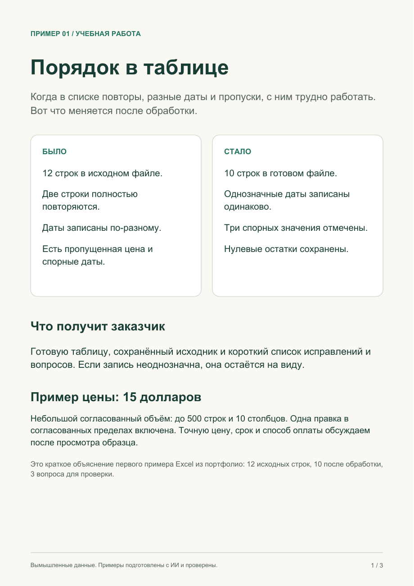
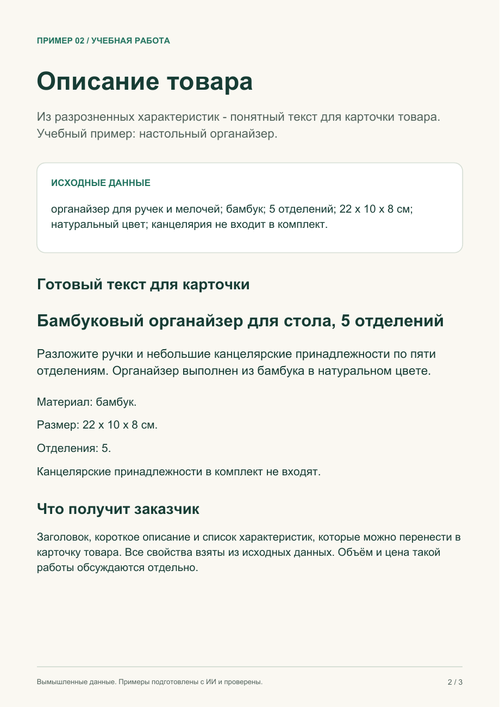
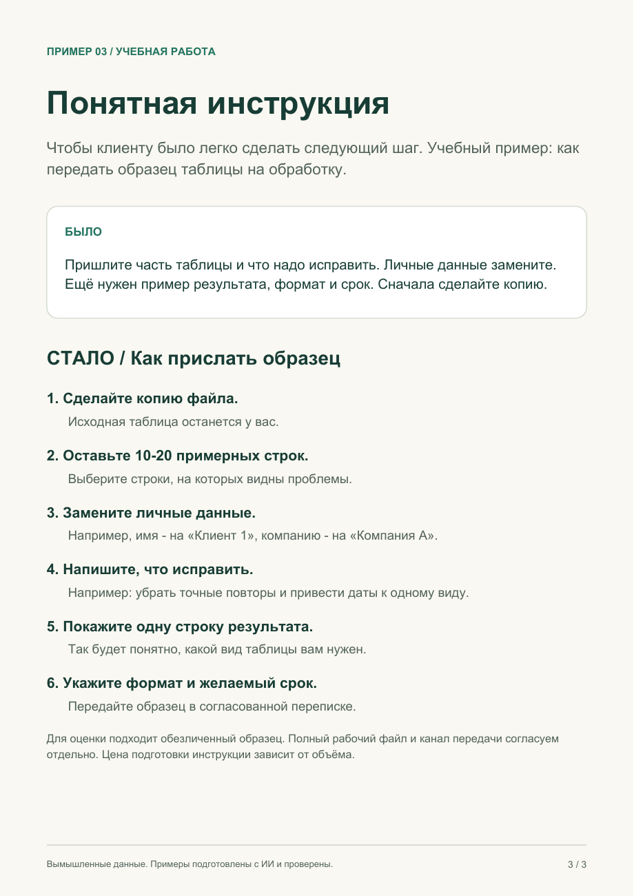

# Помощь с таблицами и понятными текстами

Нужно привести в порядок список товаров, написать описание или объяснить клиенту порядок действий? Ниже можно посмотреть, какой результат вы получите.

**[Открыть короткое портфолио: 3 страницы с примерами](portfolio.pdf)** · [English](ENGLISH.md)

## 1. Навести порядок в таблице

**Задача:** убрать точные повторы, привести понятные даты и числа к одному виду, найти пропуски. Ещё можно сравнить два списка и показать, где они расходятся.

**Пример:** было 12 строк, после удаления двух точных повторов осталось 10. Три спорных значения вынесены для уточнения. Настоящие нулевые остатки сохранены.

**Вы получите:** готовую таблицу, сохранённый исходник и короткий список исправлений и вопросов.

[Скачать пример обработки таблицы](01-spreadsheet-cleanup.xlsx) · [Скачать пример сравнения двух списков](02-list-reconciliation.xlsx)

**Пример цены - 15 долларов** за небольшой согласованный объём: до 500 строк и 10 столбцов, до трёх простых операций или сравнение двух списков общим объёмом до 500 строк. Одна правка в согласованных пределах включена.

## 2. Подготовить описание товара

**Задача:** превратить разрозненные характеристики в понятный текст для покупателя.

**Вы получите:** заголовок, короткое описание и список характеристик. В примере использованы только заданные свойства вымышленного настольного органайзера.

[Открыть готовый текст и исходные данные](03-product-description.txt)

## 3. Сделать понятную инструкцию

**Задача:** разложить сумбурное объяснение по шагам, чтобы читатель понимал, что делать дальше.

**Вы получите:** короткую памятку для клиента или сотрудника. В примере показано, как подготовить образец таблицы для оценки работы.

[Открыть инструкцию и исходный текст](04-client-instruction.txt)

## Как обсудить работу

1. Напишите, что нужно исправить или подготовить, и приложите небольшой обезличенный пример.
2. Согласуем результат, объём, цену, срок и способ оплаты.
3. После выполнения вы получите готовые материалы и пояснения к ним.

Напишите в той переписке, где получили ссылку на это портфолио. Если вам удобно пользоваться GitHub, можно [оставить запрос здесь](https://github.com/ub3dqy/spreadsheet-cleanup-examples/issues/new).

Публично размещайте только вымышленные или обезличенные примеры. Полные рабочие файлы передавайте по отдельно согласованному каналу.

Цена текстов и инструкций определяется после просмотра исходных материалов. Пример за 15 долларов относится к небольшому заданию с таблицей.

Все примеры учебные, с вымышленными данными. Они подготовлены с помощью ИИ и проверены по исходным сведениям. Это демонстрации, а не оплаченные клиентские работы или отзывы.

Подробности о проверке таблиц

В первом файле сохранены 12 исходных строк, результат из 10 строк и сведения о двух точных повторах. Неоднозначная дата, неверная дата и пропущенная цена оставлены для проверки.

Во втором файле сравниваются восемь разных кодов товаров: два совпадения и шесть случаев для проверки. Коды `0001` и `1` не объединяются. Отсутствующий товар, пустое количество, повторяющийся код и разное количество показаны отдельно.

Это готовые примеры результата. Изменение исходного листа не запускает обработку заново. Итоги пересчитываются по показанным строкам результата. Проверены сохранённые данные, расчёты и вид листов; настольный Excel для этой проверки не запускался.

