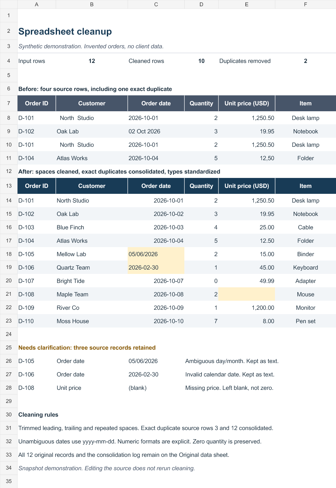
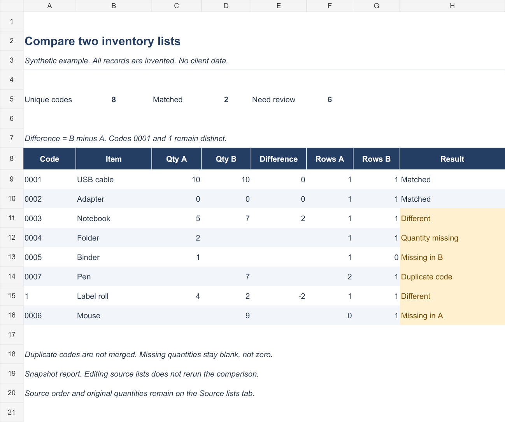

# Spreadsheet cleanup and reconciliation

Two examples of a small Excel / CSV service. All records are invented. These files contain no client data and are not presented as past paid work or testimonials.

## Examples

- [Cleanup: original data, result and exception log](01-spreadsheet-cleanup.xlsx). Twelve source records become ten after consolidating two exact full-row duplicates. Ambiguous dates, an invalid date and a missing price remain visible for review. A real zero quantity is retained.
- [Compare two inventory lists](02-list-reconciliation.xlsx). Eight distinct text codes: two matches and six cases to review. Missing records, a missing quantity, duplicate codes and quantity differences remain separate. The text codes `0001` and `1` stay distinct. Conflicting labels are flagged by the comparison routine rather than treated as a match.

These are snapshot deliverables. Editing a source sheet does not rerun cleaning or reconciliation. Summary counts recalculate from the displayed result. Files were checked with the spreadsheet authoring engine and by inspecting the exported XLSX data; desktop Excel was not executed.

## Small service offer

Pilot quote: **US$15**, subject to the actual sample and scope.

One file with up to 500 data rows and 10 source columns, with up to three simple cleanup operations, or an agreed comparison of two lists with up to 500 rows in total. Delivery includes the processed file, unchanged source and a short change/exception report. One correction within the agreed scope is included.

Scope, rules, price, deadline, acceptance check and an available payment route are agreed before work. An advance is not a universal requirement. Identifiers, leading zeroes, meaningful zeroes, blanks and conflicts are preserved or explicitly flagged. No macros, private account access, unauthorized scraping or complex financial models in the base package. AI-assisted processing with result checks.

For a quote, open an issue with a short description and a **non-sensitive, anonymized** sample. Do not post private client records, credentials, personal financial details or other confidential information. Private delivery needs an explicitly agreed channel.

## По-русски

Очистка и сверка Excel / CSV. Пилотный ориентир — **15 USD** за небольшой согласованный объём: до 500 строк и 10 столбцов, до трёх простых операций или сверка двух списков. Исходник сохраняется, повторы и неоднозначности отмечаются. Одна правка в согласованном объёме включена. Цена, срок, проверка результата и способ оплаты согласуются после просмотра образца. Для запроса используйте issue с обезличенным примером. Это демонстрации с вымышленными данными, а не оплаченные клиентские работы.
